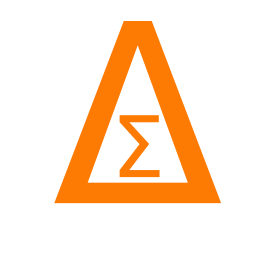

|dsflogo| Tomography
====================

DSF uses `Binny <https://binny-org.github.io/binny/main/index.html>`_ to
construct lens and source tomography from survey presets, custom redshift
distributions, or predefined bins.

The :class:`~dsf.tomography.tomo_builder.TomographyBuilder` interface
configures both samples and selects lens-source pairs. Its ``prepare_bins()``
method returns the tomographic distributions, population statistics, bin
centers, and selected pairs.

Synthetic tomography
--------------------

Binny constructs two spectroscopic lens bins and four photometric source
bins from Smail redshift distributions. The lenses include spectroscopic
uncertainties, while the sources include photometric scatter, mean-redshift
offsets, and 5% outliers. The resulting bins are passed to DSF with
number-density metadata.

.. plot::
   :include-source:

   from itertools import cycle

   import matplotlib.pyplot as plt
   import numpy as np
   from binny import build_tomography_from_spec

   from dsf import DSF_COLORS
   from dsf.tomography.tomo_builder import TomographyBuilder

   z_lens = np.linspace(0.1, 1.5, 500)
   z_source = np.linspace(0.0, 4.0, 500)

   def smail_nz(z, z0, alpha, beta):
       nz = z**alpha * np.exp(-(z / z0)**beta)
       return nz / np.trapezoid(nz, z)

   nz_lens = smail_nz(z_lens, z0=0.18, alpha=2.0, beta=1.5)
   nz_source = smail_nz(z_source, z0=0.5, alpha=2.0, beta=1.0)

   lens_result = build_tomography_from_spec(
       z=z_lens,
       nz=nz_lens,
       tomo_spec={
           "kind": "specz",
           "bins": {"scheme": "equipopulated", "n_bins": 2},
           "uncertainties": {
               "completeness": [0.99] * 2,
               "catastrophic_frac": 0.01,
               "leakage_model": "neighbor",
               "specz_scatter": 0.03,
           },
       },
   )

   source_result = build_tomography_from_spec(
       z=z_source,
       nz=nz_source,
       tomo_spec={
           "kind": "photoz",
           "bins": {"scheme": "equipopulated", "n_bins": 4},
           "uncertainties": {
               "scatter_scale": [0.02, 0.03, 0.035, 0.04],
               "mean_offset": 0.005,
               "outlier_frac": 0.05,
               "outlier_scatter_scale": 0.15,
           },
       },
   )

   tomo = TomographyBuilder(
       lens={
           "z": z_lens,
           "bins": lens_result.bins,
           "config": {
               "sample_properties": {
                   "number_density": {
                       "n_gal_comoving_h3_mpc3": 3e-4,
                   },
               },
               "population_fractions": {
                   i: 1 / 2 for i in lens_result.bins
               },
           },
       },
       source={
           "z": z_source,
           "bins": source_result.bins,
           "config": {
               "sample_properties": {
                   "number_density": {"n_gal_arcmin2": 20.0},
               },
               "population_fractions": {
                   i: 1 / 4 for i in source_result.bins
               },
           },
       },
       overlap_threshold=0.10,
       source_behind_lens=True,
   )

   inputs = tomo.prepare_bins()
   lens = inputs["lens_result"]
   source = inputs["source_result"]

   fig, ax = plt.subplots()

   for (key, nz), color in zip(
       sorted(lens.bins.items()), cycle(DSF_COLORS)
   ):
       z = np.asarray(lens.z).reshape(-1)
       nz = np.asarray(nz).reshape(-1)

       ax.fill_between(
           z, 0, nz,
           facecolor=color,
           edgecolor=color,
           alpha=0.8,
           zorder=2,
           label=f"Lens bin {key + 1}",
       )

   for (key, nz), color in zip(
       sorted(source.bins.items()), cycle(DSF_COLORS)
   ):
       z = np.asarray(source.z).reshape(-1)
       nz = np.asarray(nz).reshape(-1)

       ax.fill_between(
           z, 0, nz,
           facecolor="none",
           edgecolor=color,
           zorder=3,
           label=f"Source bin {key + 1}",
       )

   ax.set(
       xlabel=r"Redshift $z$",
       ylabel=r"Normalized $n_i(z)$",
       title="Synthetic lens and source tomography",
   )
   ax.set_ylim(bottom=0)
   ax.legend(frameon=False, ncol=2)
   fig.tight_layout()
   plt.show()

   print("Selected lens-source pairs:")
   for lens_bin, source_bin in inputs["bin_pairs"]:
       print(f"  Lens {lens_bin + 1} - Source {source_bin + 1}")

Survey tomography
-----------------

This example uses the `survey presets provided by Binny
<https://binny-org.github.io/binny/main/examples/surveys/survey_presets.html>`_
to construct three DESI LRG lens bins and LSST Y1 source bins.
Lens-source pairs are selected by requiring the mean source redshift
to exceed the mean lens redshift, with at most 10% fractional overlap.

Lens distributions are filled, while source distributions are shown as
unfilled colored outlines.

.. plot::
   :include-source:

   from itertools import cycle

   import matplotlib.pyplot as plt
   import numpy as np

   from dsf import DSF_COLORS
   from dsf.tomography.tomo_builder import TomographyBuilder

   tomo = TomographyBuilder(
       lens={
           "survey": "desi",
           "sample": "lrg",
           "role": "lens",
           "overrides": {
               "bins": {"edges": [0.4, 0.6, 0.8, 1.0]},
           },
       },
       source={
           "survey": "lsst",
           "year": "1",
           "role": "source",
       },
       overlap_threshold=0.10,
       source_behind_lens=True,
   )

   inputs = tomo.prepare_bins()
   lens = inputs["lens_result"]
   source = inputs["source_result"]

   fig, ax = plt.subplots()

   for (key, nz), color in zip(
       sorted(lens.bins.items()), cycle(DSF_COLORS)
   ):
       z = np.asarray(lens.z).reshape(-1)
       nz = np.asarray(nz).reshape(-1)

       ax.fill_between(
           z, 0, nz,
           facecolor=color,
           edgecolor=color,
           alpha=0.8,
           zorder=2,
           label=f"Lens bin {key + 1}",
       )

   for (key, nz), color in zip(
       sorted(source.bins.items()), cycle(DSF_COLORS)
   ):
       z = np.asarray(source.z).reshape(-1)
       nz = np.asarray(nz).reshape(-1)

       ax.fill_between(
           z, 0, nz,
           facecolor="none",
           edgecolor=color,
           zorder=3,
           label=f"Source bin {key + 1}",
       )

   ax.set(
       xlabel=r"Redshift $z$",
       ylabel=r"Normalized $n_i(z)$",
       title="DESI LRG and LSST Y1 tomography",
   )
   ax.set_ylim(bottom=0)
   ax.legend(frameon=False, ncol=2)
   fig.tight_layout()
   plt.show()

   print("Selected lens-source pairs:")
   for lens_bin, source_bin in inputs["bin_pairs"]:
       print(f"  Lens {lens_bin + 1} - Source {source_bin + 1}")

Configuration
-------------

``TomographyBuilder`` accepts separate ``lens`` and ``source`` dictionaries.
For survey presets, the supported entries include:

* ``survey``: Survey name, such as ``"desi"`` or ``"lsst"``.
* ``sample``: Galaxy sample, such as ``"lrg"``.
* ``year``: Survey observing year.
* ``role``: Sample role, ``"lens"`` or ``"source"``.
* ``scenario``: Optional survey scenario.
* ``overrides``: Modifications to the Binny preset.

When omitted, the lens and source configurations default to DESI LRG
and LSST, respectively.

For custom redshift distributions, provide:

* ``z``: Redshift grid.
* ``nz``: Parent redshift distribution.
* ``config``: Binny tomography specification containing the binning
  scheme and optional uncertainty parameters.

For predefined bins, provide ``z``, ``bins``, and ``config`` instead.

Lens-source pair selection is controlled by:

* ``overlap_threshold``: Maximum fractional redshift-distribution overlap
  (default ``0.10``).
* ``source_behind_lens``: Require the mean source-bin redshift to exceed
  the mean lens-bin redshift (default ``True``).

Bin centers are calculated from the mean redshift of each distribution.

Tomography products
-------------------

``prepare_bins()`` returns a dictionary with the following entries:

* ``lens_result``, ``source_result``: Binny ``Tomography`` objects.
* ``lens_bin_centers``, ``source_bin_centers``: Mean bin redshifts.
* ``lens_population_stats``, ``source_population_stats``: Population
  statistics, including number densities.
* ``lens_shape_stats``, ``source_shape_stats``: Shape statistics.
* ``lens_metadata``, ``source_metadata``: Tomographic metadata.
* ``bin_pairs``: Selected lens-source index pairs.

Each Binny ``Tomography`` result provides ``z``, ``nz``, ``bins``,
``metadata``, ``spec``, and ``survey_metadata`` attributes. The
``metadata`` attribute replaces the old ``tomo_meta`` interface.

For example:

.. code-block:: python

   inputs = tomo.prepare_bins()

   bin_pairs = inputs["bin_pairs"]
   lens_density = inputs["lens_population_stats"]["density_per_bin"]
   lens_metadata = inputs["lens_result"].metadata

Bin indices are zero-based and correspond to the Binny bin dictionary keys.

Predefined tomographic bins
---------------------------

Precomputed tomography, as in the synthetic example, requires:

* ``z``: Redshift grid.
* ``bins``: Dictionary of bin-indexed redshift distributions.
* ``config``: Binny metadata containing ``sample_properties`` and
  ``population_fractions``.

The sample properties must provide number-density information. Population
fractions must be nonnegative and sum to one.

See the `Binny documentation
<https://binny-org.github.io/binny/main/index.html>`_ for additional
survey presets and tomography configuration options.
